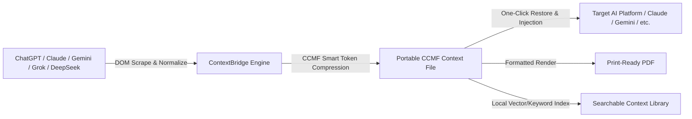

# ContextBridge

<p align="center">
  
</p>

<p align="center">
  <strong>Universal Context Transfer & Conversation Portability Engine for Modern AI Chatbots</strong>
</p>

<p align="center">
  
  
  
  
  
</p>

---

## 📌 Overview

**ContextBridge** is a privacy-first browser extension engineered to eliminate AI platform lock-in. It allows developers, researchers, and power users to export complete, multi-turn conversation threads from any major AI platform and resume them seamlessly on another — preserving formatting, code blocks, role context, and logical flow with zero data loss.

Moving a multi-hour architecture discussion from Claude to ChatGPT, benchmark testing a complex debugging session against DeepSeek, or switching from Gemini to Perplexity takes seconds without manually copying snippets, losing code indentation, or consuming unnecessary input tokens.



---

## ⚡ The Problem ContextBridge Solves

| Challenge | Without ContextBridge | With ContextBridge |
| :--- | :--- | :--- |
| **Vendor Silos** | Trapped inside proprietary chat interfaces with incompatible export options. | True conversational portability across 11+ platforms using an open format. |
| **Manual Copy-Paste** | Code blocks break, LaTeX equations garble, timestamps vanish, and role hierarchy collapses. | Full structure preservation: code languages, tables, timestamps, and reasoning. |
| **Token Bloat** | Redundant conversation filler burns up prompt limits when switching models. | **CCMF Token Reducer** trims repeated tokens and boilerplate by up to ~20%. |
| **Privacy Concerns** | Cloud sync extensions route your proprietary code and chats through external servers. | **100% on-device execution**. Zero tracking, zero telemetry, no external servers. |

---

## ✨ Key Capabilities

### 1. 📤 Lossless Multi-Turn Extraction
Extracts full conversation histories directly from client-rendered DOM trees. Automatically handles virtualized message scrollers (such as in Postman Postbot and Slack-style wrappers), lazily rendered long chats, nested code blocks, copy-button metadata, and formatted markdown.

### 2. 🗜️ CCMF Token Compression Engine
Converts verbose web page markup into **Compressed Conversation Memory Format (CCMF v2)**:
- Deduplicates repeated assistant greetings and prompt scaffolding.
- Extracts inline code blocks and data tables into a dedicated dictionary map referenced by lightweight tokens.
- Minimizes token consumption when repasting large histories into token-constrained models.

### 3. 📥 Seamless Cross-Platform Injection
Import previously saved conversations into any target AI chat with a single click. The injection runtime formats previous context into a clean, system-aligned summary block that models immediately interpret as historical turns.

### 4. 🖨️ Developer-Grade PDF & Print Engine
Generates clean, styled documentation directly from conversation threads:
- Syntax highlighting for all common programming languages.
- Distinct styling for user instructions vs. model responses.
- CSS print optimizations that eliminate browser UI artifacts and optimize margins.

### 5. 🔍 In-Memory Semantic & Text Search
Search through your library of exported chats instantly from the side panel. Look up previous solutions, architectural decisions, and code snippets offline without querying an API.

### 6. 🛡️ Air-Gapped Privacy Architecture
All parsing, compression, storage, and injection logic executes locally within your browser sandbox. ContextBridge requires no accounts, no logins, and communicates with zero analytics or backend services.

---

## 🌐 Supported Platforms

ContextBridge includes purpose-built DOM extraction adapters tailored to each platform's internal component hierarchy:

| Platform | Domain | Features Supported |
| :--- | :--- | :--- |
| **ChatGPT** | `chatgpt.com` | Full multi-turn threads, Canvas edits, code blocks, citations |
| **Claude** | `claude.ai` | Artifacts extraction, Fiber tree inspection, thinking tokens |
| **Google Gemini** | `gemini.google.com` | Workspace drafts, code view, multi-part responses |
| **DeepSeek** | `chat.deepseek.com` | DeepSeek-V3 and R1 chain-of-thought blocks, math/LaTeX |
| **Grok** | `grok.com` / `x.com` | Direct chat thread scraping, code syntax highlighting |
| **Perplexity** | `perplexity.ai` | Source citation anchors, search query metadata, follow-ups |
| **Microsoft Copilot** | `copilot.microsoft.com` | Edge/Bing chat DOM, formatting blocks, code tabs |
| **Postman Postbot** | `postman.co` / `postman.com` | Virtualized DOM scroll crawler with Monaco editor extraction |
| **LM Arena** | `lmarena.ai` / `chat.lmsys.org` | Multi-model battle threads (Side-by-Side Model A / Model B) |
| **Doubao** | `doubao.com` | Localized Chinese AI messaging structure |
| **Quark** | `quark.cn` | AI search dialog extraction |
| **Universal Adapter** | *Any web page* | Fallback heuristic engine that identifies conversational turn patterns |

---

## 🚀 Installation & Setup

### Install in Developer Mode (Chrome, Brave, Edge, Opera, Arc)

1. **Clone the repository:**
   ```bash
   git clone https://github.com/mujju-212/contextbridge.git
   ```

2. **Open your browser's extension manager:**
   - Chrome / Brave: `chrome://extensions`
   - Edge: `edge://extensions`

3. **Enable Developer Mode** using the toggle switch in the top right corner.

4. **Load the extension:**
   - Click the **Load unpacked** button.
   - Select the `contextbridge` project folder.

5. **Pin to Toolbar:**
   - Click the puzzle icon in your browser toolbar and pin **ContextBridge** for instant access.

---

## 📖 Usage Guide

### 1. Exporting a Conversation
1. Open any active conversation thread on a supported platform (e.g., ChatGPT, Claude, DeepSeek).
2. Click the **ContextBridge** icon in the toolbar.
3. Select **Export Conversation**.
4. The parser crawls the conversation hierarchy and downloads a lightweight `.json` file in CCMF format.

### 2. Importing & Continuing Context
1. Open a new chat tab on the AI platform you want to migrate to.
2. Click the **ContextBridge** extension popup or open the **Side Panel**.
3. Click **Import** and select the exported `.json` file.
4. The extension injects a structured historical context payload into the prompt editor ready for your next prompt.

### 3. Generating a PDF Report
1. Open the ContextBridge popup on any conversation page.
2. Click **Preview / Print**.
3. A clean, styled preview window opens with syntax-highlighted code blocks.
4. Press `Ctrl + P` (or `Cmd + P` on macOS) to save as PDF.

---

## 🏗️ Project Architecture

```
contextbridge/
├── manifest.json                     # Chrome Extension Manifest V3 configuration
├── background.js                     # Background service worker & tab orchestration
├── content.js                        # Page scraper injection coordinator
├── popup.html / popup.js             # Action popup UI and primary workflows
├── panel.html / panel.js             # Side panel interface for session management
├── pdf_preview.html / pdf_preview.js # Clean printable document renderer
│
├── parsers/
│   ├── _shared.js                    # Normalization helpers & CCMF serializer
│   ├── tokenReducer.js               # Heuristic compression and token optimizer
│   ├── inject_core.js                # Core input injection runtime
│   ├── universal.js                  # Fallback scraper for arbitrary web UIs
│   ├── folderIndex.js                # Local conversation grouping and indexer
│   ├── semanticSearch.js             # Offline keyword and semantic search engine
│   ├── chatgpt.js                    # OpenAI ChatGPT DOM parser
│   ├── claude.js / claude_main.js    # Anthropic Claude DOM & React Fiber parser
│   ├── claude_fiber.js               # Low-level React Fiber node traversal
│   ├── gemini.js                     # Google Gemini chat parser
│   ├── deepseek.js / deepseek_main.js# DeepSeek chat and reasoning parser
│   ├── grok.js / grok_main.js        # xAI Grok parser
│   ├── perplexity.js                 # Perplexity AI search parser
│   ├── copilot.js                    # Microsoft Copilot parser
│   ├── postman.js                    # Postman Postbot virtualized crawler
│   ├── lmarena.js                    # LMSYS Chatbot Arena dual-model parser
│   └── doubao.js / quark.js          # Doubao & Quark Chinese platform parsers
│
└── icons/
    ├── icon16.png / icon32.png       # Standard extension toolbar icons
    ├── icon48.png / icon128.png      # High-DPI and Chrome Web Store assets
    └── platforms/                    # SVG brand icons for supported platforms
```

---

## 📄 CCMF (Compressed Conversation Memory Format)

ContextBridge introduces **CCMF v2**, an open JSON schema optimized for storing conversational context with minimal overhead:

```json
{
  "v": 2,
  "p": "claude",
  "title": "System Architecture Discussion",
  "m": [
    ["u", "2026-08-08T10:14:00Z", "How can we decouple the parser runtime?"],
    ["a", "2026-08-08T10:14:45Z", {
      "txt": "We can separate DOM extraction from memory normalization using an intermediate adapter pattern.",
      "c": ["c1"]
    }]
  ],
  "c": {
    "c1": ["typescript", "interface PlatformParser {\n  extract(): ConversationTurn[];\n}"]
  },
  "t": {
    "tokens_estimated": 840,
    "compressed_savings_pct": 18.4
  }
}
```

### Schema Properties:
- `v`: Format version integer.
- `p`: Source platform identifier.
- `title`: Extracted conversation title or generated topic summary.
- `m`: Array of messages encoded as compact tuples `[role, timestamp, content]`.
- `c`: Deduplicated code repository map referenced by ID to prevent repeating code tokens.
- `t`: Compression metrics and token estimation telemetry.

---

## 🔒 Security & Permissions

ContextBridge adheres strictly to the principle of least privilege required for browser extensions:

| Permission | Technical Reason |
| :--- | :--- |
| `activeTab` | Required to inspect and parse the current conversation DOM on user request. |
| `scripting` | Executes parser functions securely within the context of supported AI web applications. |
| `storage` | Saves user preferences, compression settings, and local conversation indices. |
| `downloads` | Saves exported CCMF `.json` files and generated PDF documents to the local system. |
| `tabs` | Coordinates opening print previews and side panel context switches. |

**ContextBridge does not access external network hosts, does not collect analytics, and does not retain conversation content outside of your explicit local downloads.**

---

## 🤝 Contributing

Contributions, platform parser requests, and bug reports are welcome!

1. Fork the repository: `https://github.com/mujju-212/contextbridge`
2. Create your feature branch: `git checkout -b feature/new-parser`
3. Commit your changes: `git commit -m "feat: add support for new AI platform"`
4. Push to your branch: `git push origin feature/new-parser`
5. Open a Pull Request.

---

## ⚖️ License & Disclaimer

Distributed under the **MIT License**.

*Disclaimer: ContextBridge is an independent open-source project and is not affiliated, endorsed, or certified by OpenAI, Anthropic, Google, Microsoft, xAI, or any other listed entity. All trademarks belong to their respective owners.*
